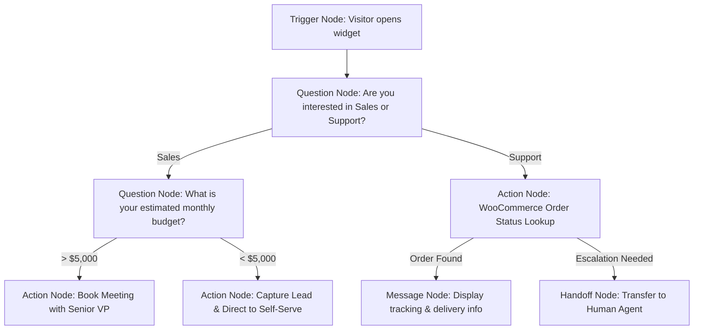
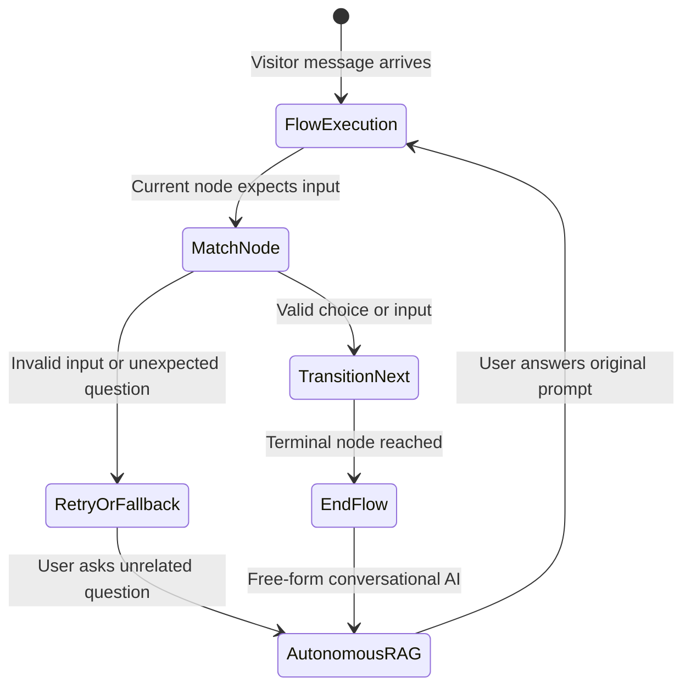

export const metadata = {
  title: "Visual Flow Builder & Architect",
  description: "Design conversational journeys, interactive decision trees, conditional logic, and CRM tool automation with the drag-and-drop visual canvas and AI Copilot."
}

import { Note, Tip, Warning, Info } from "@/components/mdx/Callout"
import { Card, CardGroup } from "@/components/mdx/Card"
import { CodeGroup } from "@/components/mdx/CodeGroup"
import { PageNav } from "@/components/PageNav"
import { prevNext } from "@/lib/navigation"

# Visual Flow Builder & Architect

The **Chatty Visual Flow Builder** provides a drag-and-drop canvas for designing structured, deterministic conversational journeys. While autonomous AI handles open-ended questions, Flow Builder gives you 100% control over mission-critical paths — such as lead qualification, booking workflows, onboarding funnels, and order lookups.



---

## Canvas Node Catalog

Flow Builder features a comprehensive library of drag-and-drop node primitives:

<CardGroup cols={2}>
  <Card title="Trigger Nodes" icon="⚡">
    Define how and when a flow starts: widget open, page URL match (e.g. `/pricing`), specific keyword intent, or button click.
  </Card>
  <Card title="Question & Input Nodes" icon="❓">
    Present quick-reply buttons, multiple choice options, free text inputs, email/phone capture with built-in regex validation.
  </Card>
  <Card title="Condition & Branching" icon="🔀">
    Fork conversations dynamically based on variables, user responses, visitor geolocation, device type, or CRM attributes.
  </Card>
  <Card title="Action & Tool Nodes" icon="🛠️">
    Execute backend automations: save CRM leads, query WooCommerce, dispatch signed webhooks, or schedule calendar events.
  </Card>
  <Card title="Message Nodes" icon="💬">
    Send text, Markdown formatting, images, downloadable files, or video snippets to the visitor.
  </Card>
  <Card title="AI Fallback & Handoff" icon="🤝">
    Seamlessly transition the conversation into autonomous RAG mode or alert human team members via Slack for live takeover.
  </Card>
</CardGroup>

---

## Node Configuration Details

### 1. Trigger Nodes
- **Widget First Open**: Fires immediately when the chat bubble is expanded for the first time in a session.
- **URL Match Pattern**: Triggers when the visitor lands on matching URL patterns (e.g. `*/checkout/*` or `*enterprise*`).
- **Keyword / Intent Match**: Uses semantic vector matching or regex to trigger specific flows (e.g. matching *"speak to human"* or *"return policy"*).
- **Inbound Channel Filter**: Restrict triggers to specific channels (e.g. WhatsApp-only flows vs Web-widget-only flows).

### 2. Question & Choice Nodes
Choice nodes prompt visitors with interactive button pills:
- **Button Choices**: Define labels and corresponding return values (e.g. `Schedule Demo` → `intent_demo`).
- **Input Validation**: Enforce formats for:
  - Email addresses (`[^\s@]+@[^\s@]+\.[^\s@]+`)
  - International phone numbers (E.164 standard)
  - Custom regex patterns
- **Maximum Retries**: Specify how many times the bot re-prompts before escalating to human support.

### 3. Condition Nodes
Branching nodes evaluate logic using standard operators (`==`, `!=`, `>`, `<`, `contains`, `is_empty`):

```json title="Example Condition Configuration"
{
  "type": "condition",
  "rules": [
    {
      "field": "visitor.budget",
      "operator": "greater_than_or_equal",
      "value": 5000,
      "target_node": "node_enterprise_vip"
    },
    {
      "field": "visitor.budget",
      "operator": "less_than",
      "value": 5000,
      "target_node": "node_standard_sales"
    }
  ],
  "fallback_node": "node_ask_more_info"
}
```

### 4. Action Nodes
- **Capture Lead**: Maps captured variables into Chatty's CRM database (`lead.name`, `lead.email`, `lead.phone`, `lead.company`, `lead.custom_fields`).
- **Calendar Booking**: Displays live availability from connected Google Calendar or Microsoft Outlook and creates meeting calendar invites automatically.
- **WooCommerce Lookup**: Searches store orders and displays real-time fulfillment status.
- **Custom Webhook**: Posts the current session JSON to external services (n8n, Zapier, Make, custom backend) with variable substitution.

---

## AI Flow Copilot (Natural Language to Canvas)

Instead of manually wiring dozen of nodes, describe your intended conversational tree to Chatty's AI Flow Copilot:

> *"Build a real estate qualification flow. Ask if the buyer is looking to buy, sell, or rent. If buying, ask for their target neighborhood and budget. If over $1M, tag as luxury buyer and offer a VIP tour booking. If under $1M, capture their email to send daily listings."*

The Copilot generates the full graph in seconds:
- Automatically positions nodes with balanced visual layout coordinates.
- Creates labeled connection edges.
- Binds question responses to variable names (`buyer_intent`, `neighborhood`, `budget`).
- Configures fallback handles back to autonomous AI.

### Generating Flows via API

You can trigger the Flow Copilot programmatically:

```bash title="Generate Flow via Copilot API"
curl -X POST "https://api.chatty.personaliai.com/api/flow/generate" \
  -H "Authorization: Bearer chatty_sk_..." \
  -H "Content-Type: application/json" \
  -d '{
    "bot_id": "a1b2c3d4-...",
    "prompt": "Create an automated IT helpdesk triage flow with password reset and technician escalation."
  }'
```

---

## State Machine Execution & AI Hybrid Fallback

Chatty operates on a hybrid architecture:



- When a visitor enters a flow, Chatty tracks the current node in the session state.
- If the visitor asks an unexpected off-topic question (e.g. *"What are your store hours?"* in the middle of a checkout flow), Chatty's autonomous RAG answers the question accurately using your knowledge base, and then politely brings the user back to the flow:
  > *"We are open Monday through Friday from 9 AM to 6 PM EST. Going back to your previous selection, would you like to continue with standard or express shipping?"*

---

## Flow Management REST API

All flow operations are fully accessible through Chatty's Developer API:

<CodeGroup>
```bash title="List Bot Flows"
curl -X GET "https://api.chatty.personaliai.com/api/flows?bot_id=YOUR_BOT_ID" \
  -H "Authorization: Bearer chatty_sk_..."
```

```bash title="Save Draft Flow"
curl -X POST "https://api.chatty.personaliai.com/api/workflow/draft" \
  -H "Authorization: Bearer chatty_sk_..." \
  -H "Content-Type: application/json" \
  -d '{
    "bot_id": "YOUR_BOT_ID",
    "name": "Lead Qualification v2",
    "nodes": [...],
    "edges": [...]
  }'
```

```bash title="Publish Flow Live"
curl -X POST "https://api.chatty.personaliai.com/api/workflow/publish" \
  -H "Authorization: Bearer chatty_sk_..." \
  -H "Content-Type: application/json" \
  -d '{
    "bot_id": "YOUR_BOT_ID",
    "flow_id": "flow_12345"
  }'
```

```bash title="Simulate / Test Flow"
curl -X POST "https://api.chatty.personaliai.com/api/workflow/test" \
  -H "Authorization: Bearer chatty_sk_..." \
  -H "Content-Type: application/json" \
  -d '{
    "bot_id": "YOUR_BOT_ID",
    "node_id": "node_question_budget",
    "input": "$7,500"
  }'
```
</CodeGroup>

<PageNav {...prevNext("/guides/flow-architect")} />
