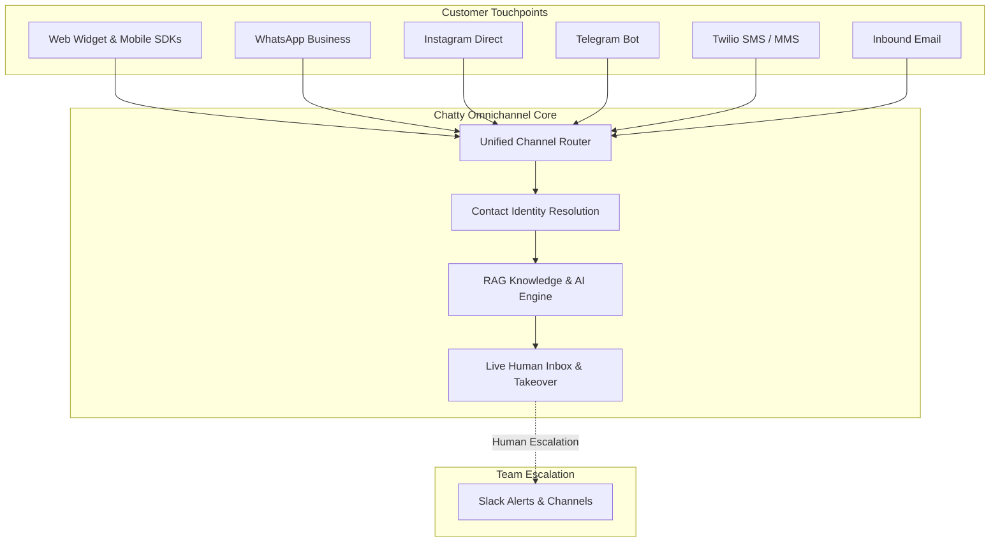

export const metadata = {
  title: "Omnichannel Integrations",
  description: "Connect WhatsApp, Instagram Direct, Telegram, Slack, Twilio SMS, and Inbound Email into a single unified AI customer support inbox."
}

import { Note, Tip, Warning, Info } from "@/components/mdx/Callout"
import { Card, CardGroup } from "@/components/mdx/Card"
import { CodeGroup } from "@/components/mdx/CodeGroup"
import { PageNav } from "@/components/PageNav"
import { prevNext } from "@/lib/navigation"

# Omnichannel Integrations

Chatty unifies all your customer communication channels into one AI-powered inbox. Whether a customer reaches out via your website widget, WhatsApp, Instagram DM, Telegram, SMS, Slack, or email, your Chatty bot provides immediate, consistent, and context-aware responses across all platforms.



---

## Supported Channels Overview

<CardGroup cols={3}>
  <Card title="WhatsApp Business" icon="💬">
    Official Meta Cloud API with Embedded Signup, catalog messages, voice notes, and media attachments.
  </Card>
  <Card title="Instagram Direct" icon="📸">
    Direct messaging, story mention replies, and customer service automation powered by Meta Graph API.
  </Card>
  <Card title="Telegram Bot" icon="✈️">
    Instant setup via `@BotFather` token with rich markdown, inline buttons, and media file support.
  </Card>
  <Card title="Slack Integration" icon="🔔">
    Escalate unresolved bot chats directly into team channels with 1-click human agent takeover buttons.
  </Card>
  <Card title="Twilio SMS / MMS" icon="📱">
    Send and receive text and picture messages worldwide with automatic two-way threading.
  </Card>
  <Card title="Email Inbound" icon="✉️">
    Turn incoming support emails (Postmark, SendGrid) into structured tickets with AI draft replies.
  </Card>
</CardGroup>

---

## Unified Contact Identity

When customers switch between channels (for example, initiating a chat on your website and later texting on WhatsApp), Chatty's **Contact Identity Engine** unifies their profile based on:
1. **Verified Phone Number** (E.164 format across WhatsApp and SMS)
2. **Email Address** (captured in chat, widget login, or inbound email)
3. **External Customer ID** (from your CRM or WooCommerce store)

All previous messages, captured leads, order histories, and internal agent notes are preserved under a single unified thread in your Chatty Live Inbox.

---

## Channel Setup Guides

### 1. WhatsApp Business (Meta Cloud API)

Chatty provides official Meta Cloud API integration with zero third-party markups.

1. Open **Dashboard → Bot Settings → Integrations → WhatsApp**.
2. Click **Connect with WhatsApp** to launch Meta's Embedded Signup dialog.
3. Select or create your Meta Business Account and assign your phone number.
4. Chatty automatically subscribes your phone number to the WhatsApp webhook:
   ```text
   GET / POST https://api.chatty.personaliai.com/webhook/whatsapp
   ```
5. Send a test message to your WhatsApp number. The AI bot will reply immediately.

<Tip title="Rich Media & Catalog Support">
Chatty natively handles WhatsApp incoming voice notes (auto-transcribed via Whisper), image/PDF documents, and renders WooCommerce product carousels directly in chat.
</Tip>

### 2. Instagram Direct Messages

1. Ensure your Instagram account is an **Instagram Professional / Business Account** and linked to a Facebook Page.
2. In Meta Business Manager, enable **Allow Access to Messages** in Instagram App settings.
3. In Chatty Dashboard under **Integrations → Instagram**, connect your Meta account.
4. Set the Instagram webhook in your Meta App:
   - **Callback URL**: `https://api.chatty.personaliai.com/webhook/instagram`
   - **Verify Token**: Found in your Chatty bot settings
   - **Subscribed Fields**: `messages`, `messaging_postbacks`, `message_deliveries`

### 3. Telegram Bot

1. Open Telegram and search for `@BotFather`.
2. Send `/newbot`, choose a display name and username (ending in `bot`).
3. Copy the **HTTP API Token** provided by BotFather (e.g. `123456789:ABCdefGhIJKlmNoPQRsTUVwxyZ`).
4. In Chatty, go to **Integrations → Telegram**, paste your API token, and click **Connect**.
5. Chatty automatically sets the Telegram webhook:
   ```bash title="Webhook Registration"
   https://api.telegram.org/bot<TOKEN>/setWebhook?url=https://api.chatty.personaliai.com/webhook/telegram
   ```

### 4. Twilio SMS / MMS

1. In your [Twilio Console](https://console.twilio.com), copy your **Account SID** and **Auth Token**.
2. Navigate to your active phone number under **Phone Numbers → Manage → Active numbers**.
3. Under **Messaging Configuration**, set **A MESSAGE COMES IN**:
   - **Webhook**: `POST https://api.chatty.personaliai.com/webhook/twilio/sms`
4. In Chatty Dashboard, enter your Twilio credentials and assigned phone number.
5. Inbound SMS and MMS picture messages will now route to your Chatty bot.

### 5. Slack Escalation & Takeover

Connect your internal team Slack workspace so support engineers can monitor bots and take over conversations in real time:

1. In Chatty Dashboard, open **Integrations → Slack**.
2. Click **Add to Slack** or configure an **Incoming Webhook URL** and default alert channel (e.g. `#support-escalations`).
3. When a visitor requests human escalation or the AI confidence score drops below your threshold, Chatty posts an alert to Slack:
   - Visitor summary and sentiment analysis
   - Conversation transcript preview
   - Interactive button: **Take Over in Chatty** (opens live chat console)

### 6. Email Inbound (Postmark & SendGrid)

Turn standard support emails (`support@yourcompany.com`) into conversational Chatty threads:

1. Configure your mail provider (Postmark, SendGrid, or Cloudflare Email Routing) to forward inbound messages via webhook to:
   ```text
   POST https://api.chatty.personaliai.com/api/inbound/email
   ```
2. Include the bot's secret header `X-Chatty-Email-Token` or route by recipient alias (e.g. `bot-{bot_id}@inbound.chatty.personaliai.com`).
3. Chatty parses email bodies, strips quoted email reply chains, executes RAG retrieval, and generates drafted replies ready for one-click agent approval.

---

## Testing Channel Connections via API

You can trigger synthetic connection diagnostics via Chatty's test endpoints:

<CodeGroup>
```bash title="Test WhatsApp"
curl -X POST \
  "https://api.chatty.personaliai.com/api/integrations/whatsapp/test" \
  -H "Authorization: Bearer chatty_sk_..." \
  -d "bot_id=YOUR_BOT_ID"
```

```bash title="Test Telegram"
curl -X POST \
  "https://api.chatty.personaliai.com/api/integrations/telegram/test" \
  -H "Authorization: Bearer chatty_sk_..." \
  -H "Content-Type: application/json" \
  -d '{"bot_id": "YOUR_BOT_ID", "bot_token": "YOUR_TELEGRAM_TOKEN"}'
```

```bash title="Test Twilio SMS"
curl -X POST \
  "https://api.chatty.personaliai.com/api/integrations/sms/test" \
  -H "Authorization: Bearer chatty_sk_..." \
  -H "Content-Type: application/json" \
  -d '{"bot_id": "YOUR_BOT_ID", "to_phone": "+15551234567"}'
```
</CodeGroup>

---

## Human Agent Takeover Across Channels

Regardless of which channel a conversation originates on, human agents can step in at any time:
- In the Chatty Live Inbox, clicking **Pause AI & Take Over** halts automated bot responses on WhatsApp, Instagram, Telegram, SMS, and Web widget simultaneously.
- When an agent types a response in the Chatty dashboard, Chatty formats and transmits the message back to the customer's native channel (e.g. sending a WhatsApp text, Instagram DM, or Telegram reply).
- Clicking **Resume AI** returns control back to your custom-trained agent.

<PageNav {...prevNext("/guides/omnichannel")} />
