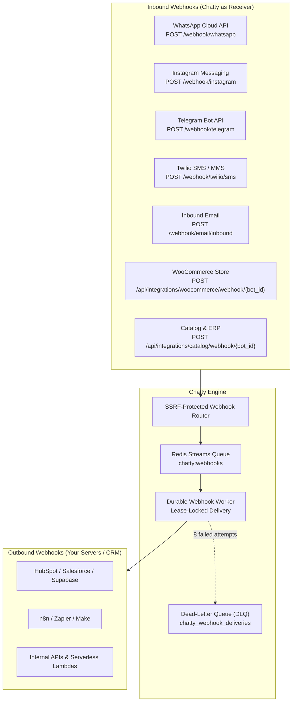

export const metadata = {
  title: "Complete Webhooks Reference",
  description: "Comprehensive guide to Chatty's inbound and outbound webhook architecture, cryptographic signature verification, event catalogs, retry engine, and channel handlers."
}

import { Note, Tip, Warning, Info } from "@/components/mdx/Callout"
import { Card, CardGroup } from "@/components/mdx/Card"
import { CodeGroup } from "@/components/mdx/CodeGroup"
import { PageNav } from "@/components/PageNav"
import { prevNext } from "@/lib/navigation"

# Complete Webhooks Reference

Chatty utilizes a bi-directional webhook architecture:
1. **Outbound Developer Webhooks**: Chatty delivers real-time signed JSON events to your servers, CRM, and automation platforms (n8n, Zapier, Make) when customer interactions happen.
2. **Inbound Channel & Commerce Webhooks**: Chatty ingests live messages and catalog updates from WhatsApp, Instagram, Telegram, Twilio SMS, Inbound Email, and WooCommerce.



---

## Part 1: Outbound Developer Webhooks

Whenever a visitor interacts with your bot, Chatty evaluates active webhook subscriptions for that bot and dispatches events.

### Subscribing to Events

#### Via Chatty Dashboard
1. Go to **Dashboard → Developer API → Webhooks**.
2. Click **Add Webhook Subscription**.
3. Enter your HTTPS URL and select the event topics to listen to.
4. Copy the generated **HMAC Secret Key** (`whsec_...`) immediately.

#### Via Developer REST API

<CodeGroup>
```bash title="Register Webhook"
curl -X POST "https://api.chatty.personaliai.com/api/bots/{bot_id}/webhooks" \
  -H "Authorization: Bearer chatty_sk_..." \
  -H "Content-Type: application/json" \
  -d '{
    "url": "https://api.yourdomain.com/webhooks/chatty",
    "events": [
      "lead.created",
      "message.user",
      "message.assistant",
      "booking.confirmed",
      "handoff.requested",
      "session.ended"
    ]
  }'
```

```bash title="List Active Webhooks"
curl -X GET "https://api.chatty.personaliai.com/api/bots/{bot_id}/webhooks" \
  -H "Authorization: Bearer chatty_sk_..."
```

```bash title="Delete / Deactivate Webhook"
curl -X DELETE "https://api.chatty.personaliai.com/api/bots/{bot_id}/webhooks/{webhook_id}" \
  -H "Authorization: Bearer chatty_sk_..."
```
</CodeGroup>

---

### Outbound Event Catalog & Payload Schemas

All outbound deliveries wrap event data in a standardized envelope:

```json title="Standard Envelope Schema"
{
  "event": "string",
  "bot_id": "uuid",
  "session_id": "string",
  "timestamp": "ISO-8601 UTC timestamp",
  "data": { ... }
}
```

#### 1. `lead.created`
Fired the instant a visitor provides contact information or when the flow extracts qualified lead data.
```json
{
  "event": "lead.created",
  "bot_id": "a1b2c3d4-e5f6-7890-abcd-ef1234567890",
  "session_id": "sess_89a0b1c2",
  "timestamp": "2026-10-23T12:30:00.000Z",
  "data": {
    "lead_id": "ld_990142",
    "name": "Alex Morgan",
    "email": "alex.morgan@example.com",
    "phone": "+14155552671",
    "source_channel": "widget",
    "custom_fields": {
      "company_size": "50-200",
      "estimated_budget": 15000,
      "urgency": "immediate"
    }
  }
}
```

#### 2. `message.user`
Fired when any customer message arrives (from widget, WhatsApp, Instagram, Telegram, SMS, or Email).
```json
{
  "event": "message.user",
  "bot_id": "a1b2c3d4-e5f6-7890-abcd-ef1234567890",
  "session_id": "sess_89a0b1c2",
  "timestamp": "2026-10-23T12:30:15.000Z",
  "data": {
    "message_id": "msg_usr_123",
    "channel": "whatsapp",
    "content": "Do you offer international shipping to Canada?",
    "sender_identity": "+14155552671"
  }
}
```

#### 3. `message.assistant`
Fired when the AI bot replies. Includes response latency in milliseconds and model execution metadata.
```json
{
  "event": "message.assistant",
  "bot_id": "a1b2c3d4-e5f6-7890-abcd-ef1234567890",
  "session_id": "sess_89a0b1c2",
  "timestamp": "2026-10-23T12:30:17.200Z",
  "data": {
    "message_id": "msg_ast_456",
    "content": "Yes! We ship to Canada via DHL Express with 3-5 business day delivery.",
    "latency_ms": 780,
    "confidence_score": 0.96,
    "sources_cited": ["https://mystore.com/shipping-policy"]
  }
}
```

#### 4. `booking.confirmed`
Fired when an appointment is successfully scheduled through Google Calendar or Microsoft Outlook integrations.
```json
{
  "event": "booking.confirmed",
  "bot_id": "a1b2c3d4-e5f6-7890-abcd-ef1234567890",
  "session_id": "sess_89a0b1c2",
  "timestamp": "2026-10-23T12:31:00.000Z",
  "data": {
    "booking_id": "bk_77189bca",
    "attendee_name": "Elena Rostova",
    "attendee_email": "elena@example.com",
    "start_time": "2026-10-25T15:00:00Z",
    "end_time": "2026-10-25T15:30:00Z",
    "meeting_url": "https://meet.google.com/xyz-uvwx-rst",
    "calendar_provider": "google"
  }
}
```

#### 5. `handoff.requested`
Fired when a visitor asks to speak with a human agent, or when sentiment/frustration analysis triggers human takeover.
```json
{
  "event": "handoff.requested",
  "bot_id": "a1b2c3d4-e5f6-7890-abcd-ef1234567890",
  "session_id": "sess_89a0b1c2",
  "timestamp": "2026-10-23T12:32:10.000Z",
  "data": {
    "conversation_id": "conv_4412abef",
    "reason": "customer_requested_agent",
    "channel": "widget",
    "last_user_message": "Can I please speak to someone in technical billing?",
    "suggested_team": "Billing Support"
  }
}
```

#### 6. `csat.submitted`
Fired when a customer submits a post-chat rating.
```json
{
  "event": "csat.submitted",
  "bot_id": "a1b2c3d4-e5f6-7890-abcd-ef1234567890",
  "session_id": "sess_89a0b1c2",
  "timestamp": "2026-10-23T12:35:00.000Z",
  "data": {
    "rating": 5,
    "feedback_text": "Super fast and answered my questions immediately!",
    "agent_type": "ai"
  }
}
```

#### 7. `session.started` & `session.ended`
- `session.started`: Fired when the conversation is initialized.
- `session.ended`: Automatically fired by Chatty's background cron scanner when a session has remained idle for 30 consecutive minutes.
```json
{
  "event": "session.ended",
  "bot_id": "a1b2c3d4-e5f6-7890-abcd-ef1234567890",
  "session_id": "sess_89a0b1c2",
  "timestamp": "2026-10-23T13:05:00.000Z",
  "data": {
    "idle_minutes": 30,
    "last_message_at": "2026-10-23T12:35:00.000Z",
    "total_messages": 8
  }
}
```

---

### Cryptographic Signature Verification (`X-Chatty-Signature`)

Every outbound POST includes an `X-Chatty-Signature` header containing the HMAC-SHA256 hash of the **raw, unparsed body bytes** signed with your subscription secret.

<CodeGroup>
```python title="Python (FastAPI / Flask / Django)"
import hmac
import hashlib

def verify_chatty_signature(raw_body_bytes: bytes, signature_header: str, secret: str) -> bool:
    """Validate incoming X-Chatty-Signature header."""
    expected = hmac.new(secret.encode("utf-8"), raw_body_bytes, hashlib.sha256).hexdigest()
    return hmac.compare_digest(expected, signature_header)
```

```typescript title="Node.js / Express / Next.js"
import crypto from "crypto";

export function verifyChattySignature(rawBodyBuffer: Buffer, signatureHeader: string, secret: string): boolean {
  const hmac = crypto.createHmac("sha256", secret);
  hmac.update(rawBodyBuffer);
  const expected = hmac.digest("hex");
  return crypto.timingSafeEqual(Buffer.from(expected), Buffer.from(signatureHeader));
}
```

```php title="PHP"
function verify_chatty_signature(string $rawBody, string $signatureHeader, string $secret): bool {
    $expected = hash_hmac("sha256", $rawBody, $secret);
    return hash_equals($expected, $signatureHeader);
}
```

```go title="Go"
package main

import (
    "crypto/hmac"
    "crypto/sha256"
    "encoding/hex"
)

func VerifyChattySignature(rawBody []byte, signatureHeader, secret string) bool {
    mac := hmac.New(sha256.New, []byte(secret))
    mac.Write(rawBody)
    expected := hex.EncodeToString(mac.Sum(nil))
    return hmac.Equal([]byte(expected), []byte(signatureHeader))
}
```
</CodeGroup>

<Warning title="Do Not Pre-Parse Body">
Always calculate the HMAC against the **raw byte buffer**. If your web framework parses the body to JSON first, re-stringifying it can modify key ordering or whitespace, resulting in validation failure.
</Warning>

---

### Delivery Retries, Lease Locks & Dead-Letter Queue (DLQ)

Chatty guarantees durable delivery through Redis Streams and database-backed leases:

1. **Inline First Attempt**: When an event triggers, Chatty publishes to the worker queue or attempts immediate HTTP POST.
2. **Timeout**: Endpoints must return an HTTP `2xx` response within **10 seconds**.
3. **Lease Locking**: When worker crons pick up retries, they acquire a randomized `processing_token` with a 10-minute lease cutoff. This prevents double-delivery across autoscaled instances.
4. **Exponential Backoff Schedule**:
   Failed deliveries are rescheduled across 8 total attempts:
   | Attempt | Delay Before Next Retry | Cumulative Elapsed Time |
   |---|---|---|
   | Attempt 1 | Immediate | 0s |
   | Attempt 2 | 1 second | 1s |
   | Attempt 3 | 5 seconds | 6s |
   | Attempt 4 | 30 seconds | 36s |
   | Attempt 5 | 5 minutes (300s) | ~5.5 min |
   | Attempt 6 | 30 minutes (1,800s) | ~35.5 min |
   | Attempt 7 | 2 hours (7,200s) | ~2.5 hours |
   | Attempt 8 | 8 hours (28,800s) | ~10.5 hours |
5. **Dead-Letter Queue**: If an endpoint fails after Attempt 8, delivery status transitions to `failed` and is stored in your bot's DLQ. Failed deliveries can be inspected and manually replayed from **Dashboard → Webhook Logs**.

---

## Part 2: Inbound Channel Webhooks

Chatty provides production-ready webhook endpoints for receiving events from third-party networks:

### 1. WhatsApp Cloud API Webhook
- **Verification Endpoint**: `GET https://api.chatty.personaliai.com/webhook/whatsapp`
  - Validates `hub.mode=subscribe`, `hub.verify_token`, and returns `hub.challenge`.
- **Receiver Endpoint**: `POST https://api.chatty.personaliai.com/webhook/whatsapp`
  - Validates Meta's `X-Hub-Signature-256`.
  - Idempotency: Deduplicates incoming message IDs using Redis keys with a 1-hour TTL.
  - Automatically downloads voice notes, runs Whisper transcription, and handles images/PDFs.

### 2. Instagram Direct Webhook
- **Verification Endpoint**: `GET https://api.chatty.personaliai.com/webhook/instagram`
- **Receiver Endpoint**: `POST https://api.chatty.personaliai.com/webhook/instagram`
  - Subscribes to `messages`, `messaging_postbacks`, and `message_deliveries`.
  - Handles story mentions, media attachments, and quick replies.

### 3. Telegram Bot API Webhook
- **Receiver Endpoint**: `POST https://api.chatty.personaliai.com/webhook/telegram`
  - Verifies `X-Telegram-Bot-Api-Secret-Token`.
  - Parses Telegram `update` objects (messages, photos, callback queries).

### 4. Twilio SMS / MMS Webhook
- **Receiver Endpoint**: `POST https://api.chatty.personaliai.com/webhook/twilio/sms`
  - Verifies `X-Twilio-Signature` using your Twilio Auth Token.
  - Normalizes sender phone numbers into E.164 format and parses MMS image attachments.

### 5. Inbound Email Webhook
- **Receiver Endpoints**:
  - `POST https://api.chatty.personaliai.com/webhook/email/inbound`
  - `POST https://api.chatty.personaliai.com/webhook/resend-inbound`
  - `POST https://api.chatty.personaliai.com/api/webhooks/inbound-email`
  - Supports Postmark, SendGrid, and Resend inbound parsing.
  - Automatically strips quoted reply history and runs AI retrieval to generate draft replies for your support agents.

---

## Part 3: E-Commerce & Catalog Inbound Webhooks

### WooCommerce Store Webhook
- **Endpoint**: `POST https://api.chatty.personaliai.com/api/integrations/woocommerce/webhook/{bot_id}`
- **Security**: Verifies `X-WC-Webhook-Signature` against your bot's WooCommerce secret.
- **Handled Topics**:
  - `product.created`: Ingests and generates vector embeddings for new items.
  - `product.updated`: Updates prices, sale discounts, variant attributes, and stock status in real-time.
  - `product.deleted`: Purges removed items from RAG knowledge bases instantly.
  - `order.created` & `order.updated`: Caches fulfillment, shipment tracking, and delivery status for conversational order inquiries.

### Catalog ERP/PIM Webhook
- **Endpoint**: `POST https://api.chatty.personaliai.com/api/integrations/catalog/webhook/{bot_id}`
- Synchronize product catalog data from SAP, Akeneo, Shopify, or internal databases using your custom `external_id`.

```json title="Catalog Sync Event"
{
  "event": "product.updated",
  "external_id": "SKU-99401",
  "item": {
    "title": "Aero Carbon Road Bike",
    "price": 2899.00,
    "in_stock": true,
    "inventory_count": 18
  }
}
```

---

## Part 4: Billing & Subscription Webhooks

- **Endpoint**: `POST https://api.chatty.personaliai.com/webhook/lemonsqueezy`
- **Security**: Verifies Lemon Squeezy's `X-Signature`.
- **Handled Events**: `subscription_created`, `subscription_updated`, `subscription_cancelled`, `subscription_resumed`, and `order_created`.
- **Automations**: Automatically provisions plan quotas, updates team seats, and tracks affiliate referral commissions.

---

## Best Practices & Security Checklist

<CardGroup cols={2}>
  <Card title="Acknowledge Immediately" icon="⚡">
    Return an HTTP `200 OK` response within 10 seconds. Offload processing to a background job queue (Redis, Celery, SQS, BullMQ).
  </Card>
  <Card title="Always Validate Signatures" icon="🔒">
    Reject any request that fails `X-Chatty-Signature` verification with an immediate `401 Unauthorized`.
  </Card>
  <Card title="Ensure Idempotency" icon="🔁">
    Network retries may cause duplicate delivery attempts. Use the event payload `delivery_id` or `session_id` + `timestamp` as an idempotency key.
  </Card>
  <Card title="SSRF Protection" icon="🛡️">
    Chatty validates outbound destination IPs and pins DNS connections to prevent internal network and loopback probing.
  </Card>
</CardGroup>

<PageNav {...prevNext("/guides/webhooks")} />
