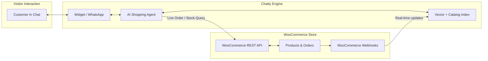

export const metadata = {
  title: "WooCommerce Integration",
  description: "Connect your WooCommerce store to Chatty for live product search, instant order tracking, real-time catalog sync, and interactive shopping in chat."
}

import { Note, Tip, Warning, Info } from "@/components/mdx/Callout"
import { Card, CardGroup } from "@/components/mdx/Card"
import { CodeGroup } from "@/components/mdx/CodeGroup"
import { PageNav } from "@/components/PageNav"
import { prevNext } from "@/lib/navigation"

# WooCommerce Integration

Transform your Chatty AI bot into a high-converting 24/7 sales assistant for your WooCommerce store. The native WooCommerce integration allows Chatty to answer customer questions with real-time catalog data, display interactive product cards, check live inventory, and track customer orders securely inside the chat window.



---

## Key Features

<CardGroup cols={2}>
  <Card title="Live Product Discovery" icon="🛍️">
    Semantic vector search understands natural queries like *"Do you have running shoes with extra arch support under $120?"* and returns relevant, in-stock products.
  </Card>
  <Card title="Interactive Product Cards" icon="💳">
    Displays visual product cards with images, formatted store currency, current stock status, and direct **Add to Cart** or **Checkout** links.
  </Card>
  <Card title="Automated Order Tracking" icon="📦">
    Visitors can ask *"Where is my order #12450?"*. Chatty securely validates their email or phone number, then displays carrier tracking, shipping status, and fulfillment updates.
  </Card>
  <Card title="Real-Time Catalog Sync" icon="🔄">
    When products are added, updated, or marked out of stock in WooCommerce, Chatty automatically syncs via signed webhooks with zero manual re-indexing.
  </Card>
</CardGroup>

---

## Connecting Your Store

Chatty supports both **1-Click OAuth Connection** (recommended for non-technical store owners) and **Manual API Key Setup** (for staging, intranet, or custom WooCommerce deployments).

### Method A: 1-Click OAuth Setup (Recommended)

1. Open **Chatty Dashboard → Bot Settings → Integrations → WooCommerce**.
2. Enter your store's public HTTPS URL (e.g. `https://mystore.com`).
3. Click **Connect with WooCommerce**.
4. You will be redirected to your WordPress admin screen asking to approve API permissions for Chatty.
5. Click **Approve**. WooCommerce automatically provisions read/write keys and registers real-time webhooks back to Chatty.

### Method B: Manual API Key Provisioning

If your WordPress server blocks OAuth callbacks or runs behind Cloudflare Access, configure keys manually:

1. In WordPress WP-Admin, navigate to **WooCommerce → Settings → Advanced → REST API**.
2. Click **Add Key**.
   - **Description**: `Chatty AI Integration`
   - **User**: Select an admin or shop manager user
   - **Permissions**: **Read/Write** (required to auto-register webhooks and query live orders)
3. Click **Generate API Key**. Copy the **Consumer Key** (`ck_...`) and **Consumer Secret** (`cs_...`).
4. In Chatty Dashboard, enter:
   - **Store URL**: `https://mystore.com`
   - **Consumer Key**: `ck_xxxxxxxxxxxxxxxxxxxxxxxxxxxxxxxxxxxxxxxx`
   - **Consumer Secret**: `cs_xxxxxxxxxxxxxxxxxxxxxxxxxxxxxxxxxxxxxxxx`
5. Click **Save & Test Connection**.

<Tip title="SSL Certificate Required">
WooCommerce REST API v3 strictly requires HTTPS. Ensure your store serves a valid SSL certificate; HTTP connections are rejected by WooCommerce core for security.
</Tip>

---

## Bi-Directional Webhook Synchronization

Once connected, Chatty automatically registers the following webhook listeners on your WooCommerce store:

| Webhook Event | WooCommerce Topic | Chatty Action |
|---|---|---|
| `product.created` | `Product Created` | Indexes new product title, description, attributes, variants, and price into bot knowledge base. |
| `product.updated` | `Product Updated` | Updates pricing, stock status (`instock` / `outofstock`), sale prices, and description in real time. |
| `product.deleted` | `Product Deleted` | Removes deleted or trashed products immediately from AI recommendations. |
| `order.created` | `Order Created` | Caches order metadata for instant conversational tracking. |
| `order.updated` | `Order Updated` | Updates fulfillment status (e.g. `processing` → `completed`), tracking number, and carrier info. |

### Webhook Delivery Endpoint

WooCommerce sends signed payloads to your bot's dedicated ingestion route:

```text
POST https://api.chatty.personaliai.com/api/integrations/woocommerce/webhook/{bot_id}
```

Chatty verifies every delivery against the secret provisioned during connection setup. Webhooks that fail HMAC SHA-256 verification are dropped with `401 Unauthorized`.

---

## Conversational Shopping Experience

### Product Recommendation Cards

When Chatty detects product inquiry intent, it formats store responses into visual product widgets inside the web chat or rich WhatsApp catalog messages:

```json title="Example Bot Response Action"
{
  "role": "assistant",
  "content": "Here are our top waterproof trail running shoes:",
  "products": [
    {
      "id": 1042,
      "name": "Apex Waterproof Trail Runner",
      "price": "$129.00",
      "regular_price": "$149.00",
      "on_sale": true,
      "stock_status": "instock",
      "permalink": "https://mystore.com/product/apex-trail-runner",
      "add_to_cart_url": "https://mystore.com/cart/?add-to-cart=1042",
      "thumbnail": "https://mystore.com/wp-content/uploads/apex-shoe.jpg"
    }
  ]
}
```

### Direct Cart Actions

You can configure Chatty's CTA behavior in **Widget Settings → Commerce**:
- **Direct Add to Cart**: Clicking the button adds the item directly to the customer's cart via `/?add-to-cart={product_id}` and opens checkout.
- **Product Page**: Navigates the visitor to the full product detail page.
- **WhatsApp Catalog Checkout**: On WhatsApp channels, sends native Meta Catalog items allowing in-app cart collection.

---

## Order Status & Security Verification

To prevent unauthorized order inspection, Chatty enforces a strict verification challenge before revealing order details:

1. **Visitor Prompt**: *"Where is my order #10842?"*
2. **Identity Challenge**: If the visitor is not logged into WordPress or their session email is unverified, Chatty prompts:
   > *"To protect your privacy, please verify the email address or phone number used when placing order #10842."*
3. **Validation**: Chatty compares the user's input with the billing email/phone on the WooCommerce order.
4. **Order Summary**: Upon a match, Chatty returns:
   - Order Status (`Processing`, `Shipped`, `Completed`, `On hold`)
   - Tracking Carrier & Tracking Number link (supports WooCommerce Shipment Tracking, ShipStation, AfterShip)
   - Estimated Delivery Date
   - Line items summary and total amount paid

<Warning title="Customer Privacy Enforcement">
Chatty will never reveal recipient physical addresses or payment credit card details over chat, regardless of authentication state.
</Warning>

---

## WooCommerce Management API

Developers can manage WooCommerce store links programmatically via the Chatty REST API:

<CodeGroup>
```bash title="Get Store Status"
curl -X GET \
  "https://api.chatty.personaliai.com/api/bots/{bot_id}/integrations/woocommerce" \
  -H "Authorization: Bearer chatty_sk_..."
```

```bash title="Connect Store"
curl -X POST \
  "https://api.chatty.personaliai.com/api/bots/{bot_id}/integrations/woocommerce/connect" \
  -H "Authorization: Bearer chatty_sk_..." \
  -H "Content-Type: application/json" \
  -d '{
    "store_url": "https://mystore.com",
    "consumer_key": "ck_xxxxxxxxxxxxxxxxxxxxxxxxxxxxxxxxxxxxxxxx",
    "consumer_secret": "cs_xxxxxxxxxxxxxxxxxxxxxxxxxxxxxxxxxxxxxxxx"
  }'
```

```bash title="Trigger Full Re-sync"
curl -X POST \
  "https://api.chatty.personaliai.com/api/bots/{bot_id}/integrations/woocommerce/sync" \
  -H "Authorization: Bearer chatty_sk_..."
```

```bash title="Disconnect Store"
curl -X DELETE \
  "https://api.chatty.personaliai.com/api/bots/{bot_id}/integrations/woocommerce" \
  -H "Authorization: Bearer chatty_sk_..."
```
</CodeGroup>

<PageNav {...prevNext("/guides/woocommerce")} />
